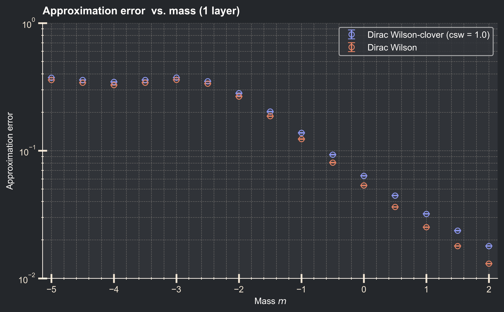
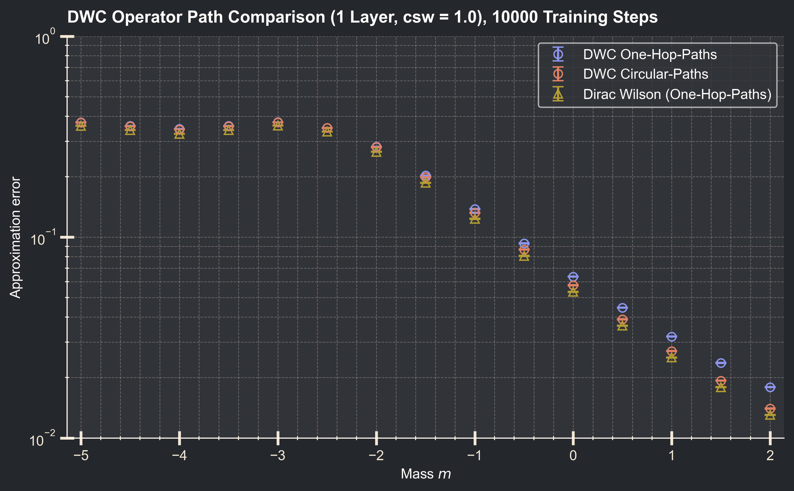
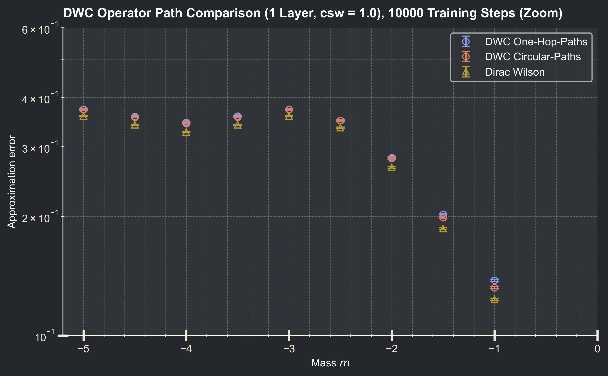
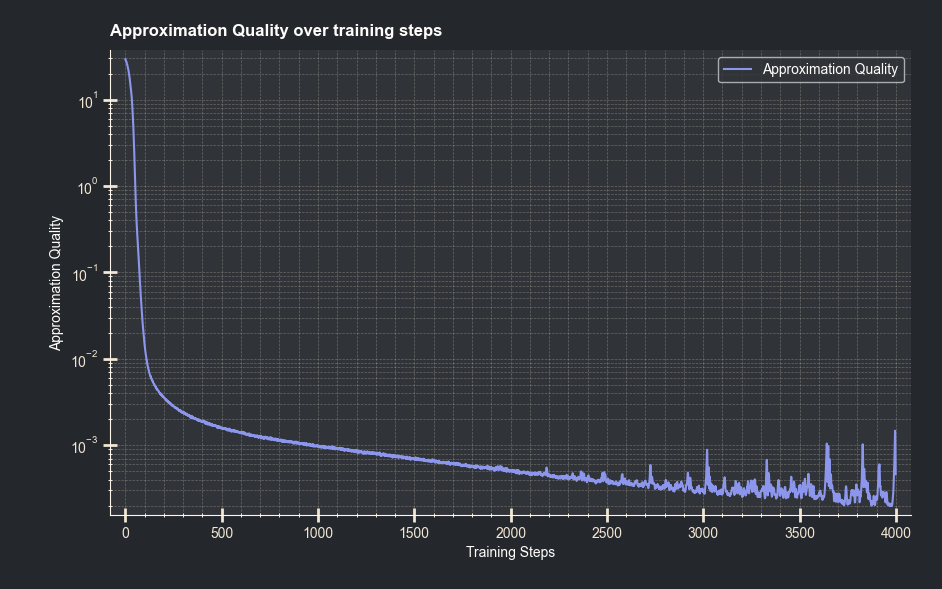

# Progress Report 1
##### One-Hop DW vs DWC
Zunächst habe ich die bestehende One-Hop Architektur, wie wir sie bisher beim Dirac Wilson (DW) Operator verwendet haben nun für den Dirac Wilson Clover (DWC) Operator angewendet und die Ergebnisse verglichen.

 

Die Plots wurden dabei mit jeweils 10000 Training steps pro Massenpunkt (wobei die Konvergenz schon nach nur wenigen Hundert erreicht war), Weight Initialisierung mit der Identity und sonst mit dem Paper identischen Einstellungen erstellt.

---

 

##### DWC Plaquette Paths
Als nächstes habe ich die Circular Plaquette Paths implementiert und habe meinen bestehenden Code angepasst, um wie folgt modular schnell zwischen den Pathtypen wechseln zu können:

 

    def path_generator(type: int):

        zero_hop_paths = [[]]
        one_hop_paths = [[(mu, 1)] for mu in range(4)] + [[(mu, -1)] for mu in range(4)]

        circular_paths = []

        for mu in range(4):
            for nu in range(4):
                if nu == mu:
                    continue
                circular_paths.append([(mu, 1), (nu, 1), (mu, -1), (nu, -1)])
                circular_paths.append([(mu, 1), (nu, -1), (mu, -1), (nu, 1)])
                circular_paths.append([(mu, -1), (nu, 1), (mu, 1), (nu, -1)])
                circular_paths.append([(mu, -1), (nu, -1), (mu, 1), (nu, 1)])

        match type:
            case 1:
                return zero_hop_paths
            case 2:
                return zero_hop_paths + one_hop_paths
            case 3:
                return zero_hop_paths + one_hop_paths + circular_paths

 

Hierzu habe ich ebenso die Approximation Quality, mit sonst identischen Einstellungen für den DWC mit beiden Path Varianten und den DW als Vergleich geplottet:

 

 

Hierbei fällt auf, dass der Vorteil in Approximation Quality für negative Massen nur sehr gering ausfällt. Ein Fokus auf diesen Bereich ist im nächsten Plot sichtbar:

 

 

---

 

##### Speed Comparison

Während die One-Hop-Paths zu 9 Feature-Channel in den PT-Layers führen, werden mit den Circular Paths 57 Feature-Channel erzeugt. Erste experimentelle Vegleiche, bei sonst identischen Parametern und Berechnung auf Cuda zeigen, dass sich dabei die Geschwindigkeit eine feste Anzahl an Training Steps zu erreichen mit einer Anpassung von One-Hop-Paths auf Circular-Paths um einen Faktor **3,6** bei **einer** Layer verlängert und Faktor **6,1** bei **vier** Layers.

 

Hierbei ist es nicht überraschend, dass eine höhere Anzahl an Layers einen anderen Faktor verursacht, da die ersten und letzten Clifford Layers anders als die intermediate Layers skalieren. Hier könnte man bei Interesse auch das theoretische Scaling berechnen oder erweiterte Analysen im Zusammenhang mit Layers und Massen anstellen.

---

 

##### One-Hop DW vs DWC Multilayer

Beim Trainieren für eine höhere Anzahl an Layern bin ich auf das Problem gestoßen, dass schon bei nur einer geringen Anzahl an Layers beim Training für positive Massen nach einigen Tausenden Training Steps plötzliche Spikes in der Approximation Quality auftreten, welche auch zu einem sichtbar schlechterem Endergebnis führen.
 
Ein Beispiel ist dabei hier dargestellt für eine Architektur von DW, 4 Layers und Weight Initialisierung mit der Identity für die Masse m = 2.0:

 

 
Da die Spikes immer plötzlich und auch bei verschiedenen Durchläufen ab dem selben Training Step beginnen, habe ich daraufhin begonnen mit einer Reduktion in der Learning Rate zu experimentieren, wodurch die Spikes völlig reduziert werden können. Daraufhin habe ich auch learning rate scheduler wie ReduceLROnPlateau ausprobiert.
 
 
Final habe ich aber die Erkenntnis gewonnen, dass man dadurch auch nicht auf die Werte für positive Massen und mehrere Layer aus dem Paper kommt und diese lediglich nur durch die Initialisierung mit der Hopping Expansion erzielt werden können, welche ich allerdings noch nicht selber implementiert habe.
 
 
Dies stellt sich zum Problem dar, da auch in dem Bereich den ich untersuchen soll, für m = 0.0 und 16 Layers die Spikes auftreten.

---

 

##### Sonstiges
Weiterführend habe ich mich mit Slurm Job Arrays beschäftigt, um Plots mit mehreren Massen effizient und einfach für verschiedene Konfigurationen zu erstellen.

##### Code

[Aktueller Code]({{ site.github.repository_url }}/tree/main/current_code)