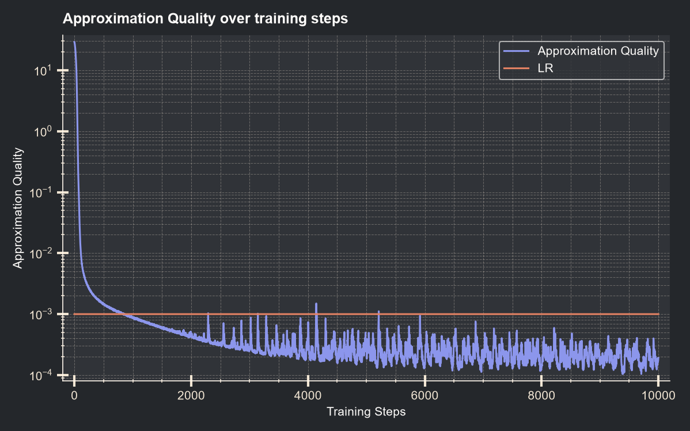
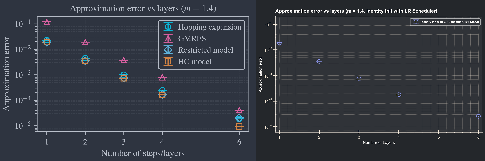

# Scheduler Optimization

Die aktuell besten Ergebnisse wurden mit dieser Konfiguration erzielt:

 

$$
\begin{aligned}
V &= 4^3 \times 8 \\
\end{aligned}
$$

 

    torch.optim.Adam(
        model.parameters(), 
        lr=0.001, 
        betas=(0.9, 0.999))

    torch.optim.lr_scheduler.ReduceLROnPlateau(
        optimizer, 
        "min", 
        factor = 0.9, 
        patience = 100, 
        threshold =1e-6,
        threshold_mode="rel",
        cooldown=100, 
        min_lr = 1e-5)

 

Aus experimentellen Versuchen lässt sich soweit schließen: 
1. Das Auftreten von Instabilitäten führt nicht zwangsläufig zu einer Verschlechterung im Training. So kann die unter den Instabilitäten zugrunde liegende Kurve weiterhin sichtbar konvergieren. 

 

2. Es zeigt sich außerdem, dass auch ohne Instabilitäten eine Verringerung der Learning Rate in manchen Fällen zu einem besseren Endergebnis im Training führen kann. Manchmal sogar mit einer sichtbar schnelleren Konvergenz ab Verringerung der Learning Rate

 

Daher habe ich aktuell versucht Parameter zu finden, die möglichst konservativ die Learning Rate verringern, ebenso aber auch das Auftreten von starken Instabilitäten vermeiden. Die aktuell besten Parameter sind oben abgebildet.

 

---

 

##### DW, 4 Layers, Pathtype 2, Identity Initialization
Hier ist noch einmal die Trainingskurve ohne Learning Rate Scheduling mit der Identity Expansion für $m=2.0$ abgebildet:
 

 

Hier ist das bislang beste Ergebnis für dieselbe Architektur mit Identity Initialisierung und der Verwendung von `ReduceLROnPlateau` abgebildet:

 

Wie man sehen kann konnte durch das Learning Rate Scheduling eine starke Verbesserung in der finalen Approximation Quality erzielt werden. So erhalte ich nun einen Wert von $7.8 \cdot 10^{-5}$ nach 10 000 Training Steps, welcher schon nahezu den Wert von ungefähr $6 \cdot 10^{-5}$ aus dem Paper reproduziert.

 

Bei einem Training mit bis zu 20 000 Training Steps konnte ein Endergebnis von $6.9 \cdot 10^{-5}$ erzielt werden:

 

Zum Vergleich ist hier noch einmal die Kurve mit der Hopping Initialisierung abgebildet:

 

 

---

 

##### Vergleich zwischen Paper und LR Scheduler für große Massen

 

 

Hier habe ich die neue Konfiguration des LR Schedulers mit dem im Paper vorhandenen Plot verglichen. Es lässt sich erkennen, dass nun auch für große Massen diese Werte bis zu vier Layer reproduziert werden können. Lediglich ab sechs und mehr Layer reichen die bestehenden 10 000 Training Steps nicht dafür aus.

Sonstige Ergebnisse für geringe Anzahl an Layer und niedrige Massen bleiben unverändert und reproduzieren weiterhin problemlos die bestehenden Werte aus dem Paper.

 

---

 

##### Fazit und weitere Schritte
Durch das weitere Experimentieren mit den Parametern des LR Schedulers hat sich gezeigt, dass mittels Identity Initialisierung eine Approximation Quality wie mit der Hopping Initialisierung in einer angemessenen Anzahl von Training Steps erzielt werden kann.

Ein gezieltes Testen der Parameterlandschaft für ein bestmögliches Endergebnis mittels Hyperparameter Tuning wie **Optuna** habe ich bereits begonnen. 

Hierbei steht noch aus ob es eine universell beste Konfiguration für den LR Scheduler gibt, welche sowohl für alle Massen und Architekturen das bestmögliche Ergebnis erzielt oder ob diese architekturspezifisch ist.